# Results — snapshot 20261025-1832Z

As of 2026-10-25T18:32:16.601Z. Coverage, error rate and headline numbers are in the [run summary](summary.md).

The top packages of each registry. A random sample of active packages is reported [beside it](random/README.md), and the two are [compared](layers.md).

> **Note:** This project was developed with AI assistance (Claude Code) under the author's direction.
> Every detection rule is documented in the methodology and traceable to the registry response it was
> read from, and every curated claim quotes an archived source, so results can be checked independently.
> Please verify findings before relying on them.

## Trust summary

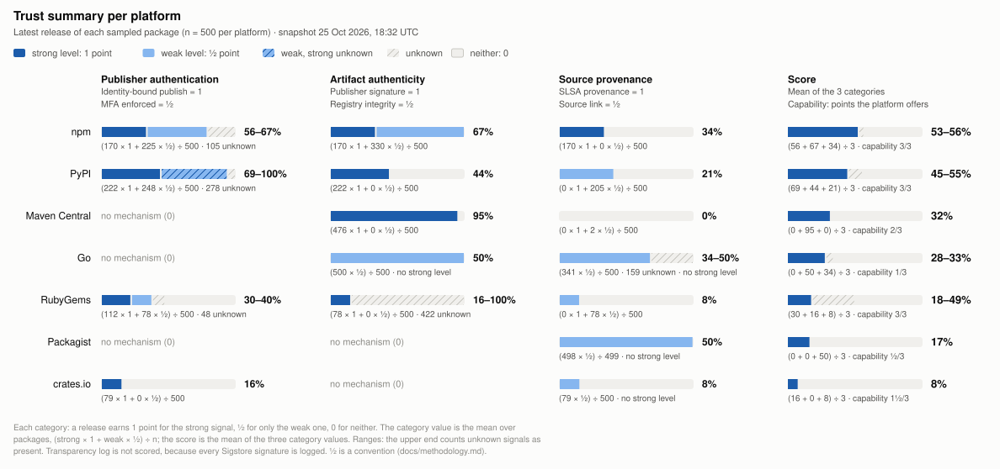

## Signal adoption

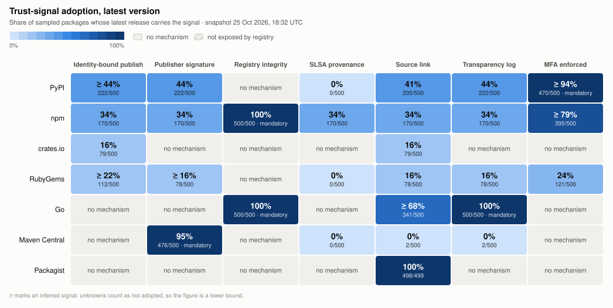

The [adoption matrix](matrix.md) as a table, with what each inferred cell is inferred from.

## How releases were published

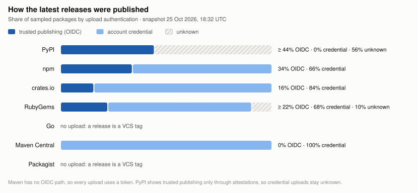

## Adoption over time

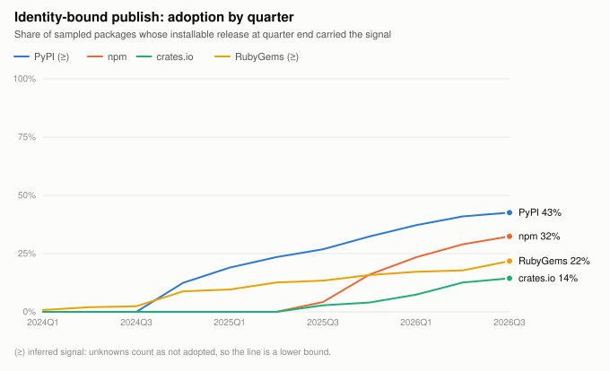

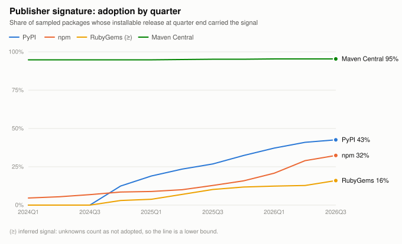

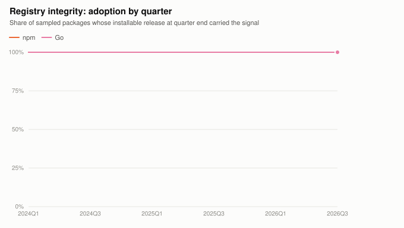

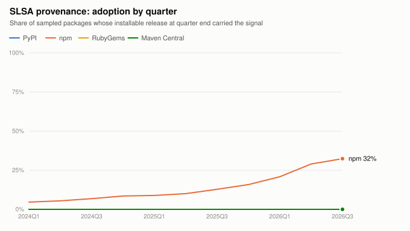

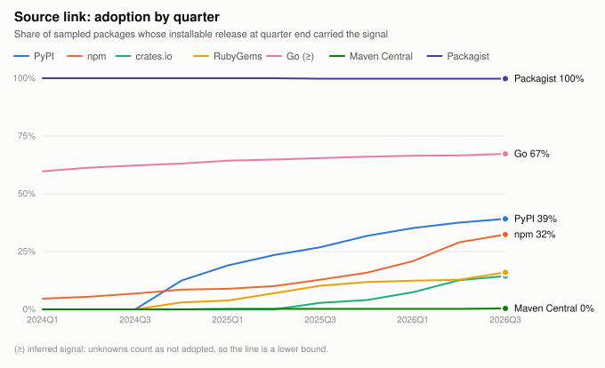

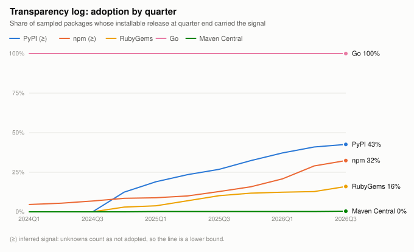

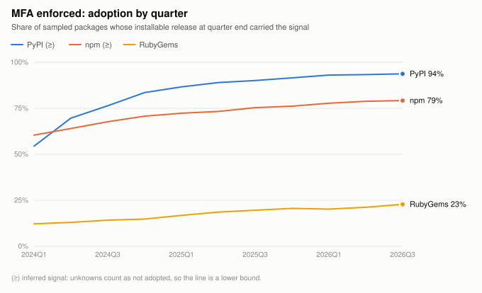

## Registry baseline

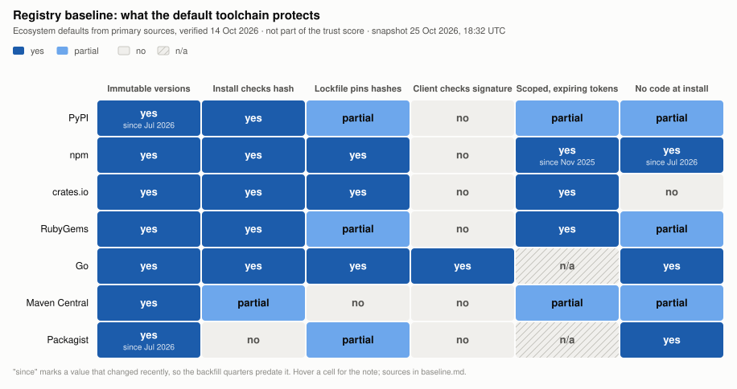

Notes and sources for every cell: [registry baseline](baseline.md).

## Governance and containment

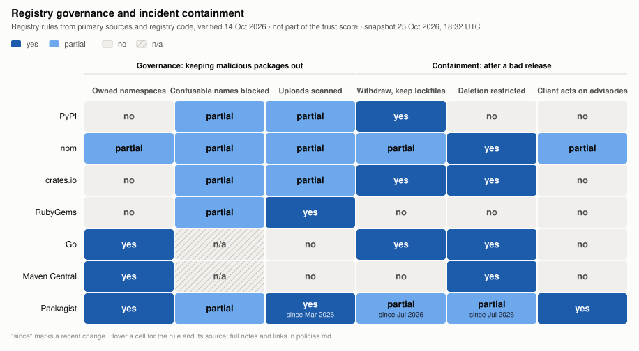

Notes and sources for every cell: [governance and containment](policies.md).

## Withdrawals

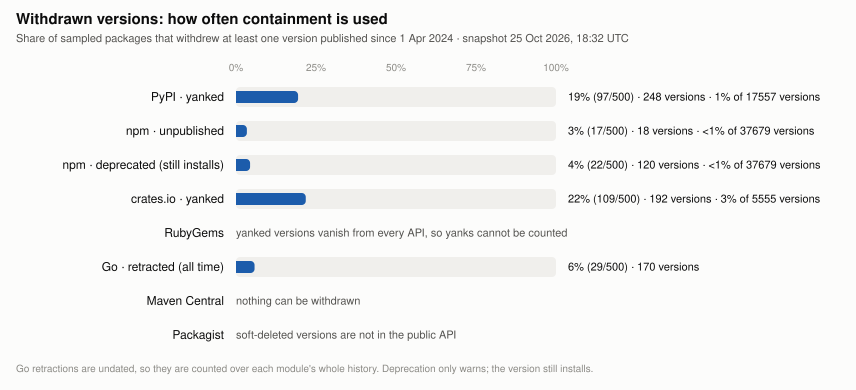

Per package, with the version numbers: [withdrawals.csv](withdrawals.csv).

## Known advisories

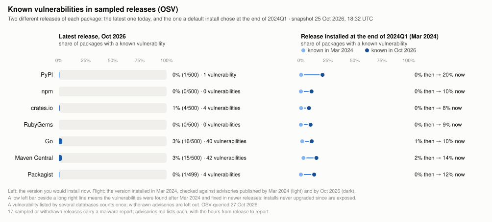

Malware reports, which databases list each vulnerability and how late, and the method: [known advisories](advisories.md).

## Sigstore

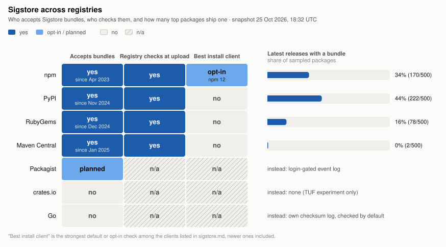

Notes and sources for every cell: [Sigstore](sigstore.md).

## Post-quantum exposure

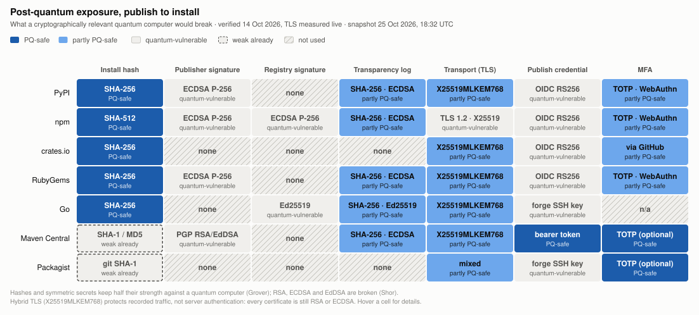

Notes and sources for every cell: [post-quantum exposure](pqc.md).

## Data

| File | Contents |
|---|---|
| [packages.csv](packages.csv) | The sampled packages |
| [signals.csv](signals.csv) | Every signal with its evidence, rule and the responses it was read from |
| [matrix.csv](matrix.csv) | Ecosystem × signal adoption |
| [timeseries.csv](timeseries.csv) | Signal adoption per quarter |
| [scores.csv](scores.csv), [score_series.csv](score_series.csv) | Trust summary per ecosystem, overall and per quarter |
| [baseline.csv](baseline.csv), [policies.csv](policies.csv), [sigstore.csv](sigstore.csv), [pqc.csv](pqc.csv) | The curated tables, with their sources |
| [withdrawals.csv](withdrawals.csv) | Versions yanked, unpublished, deprecated or retracted, per package |
| [advisories.csv](advisories.csv) | Every OSV record matched to a sampled or withdrawn version, with its purl and dates |
| [sbom.cdx.json](sbom.cdx.json) | CycloneDX SBOM: the latest version of every sampled package and its known vulnerabilities |
| [aggregate.json](aggregate.json) | Everything above, as the report stage reads it |
| [requests.json](requests.json) | Responses per host and status, and the sha256 of the full request manifest published with the cache |
